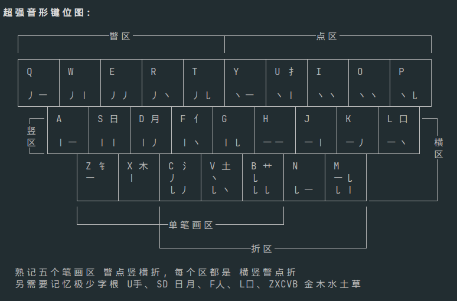

# RIME 配置

基于rime实现的 以小鹤双拼作为双拼方案 以超强音形(二笔)作为辅助码 实现的输入方案

## Features

- [小鹤双拼](#小鹤双拼)
- [万象语言模型](#万象语言模型)
- [emoji混输](#emoji混输)
- [中英混输](#中英混输)
- [基于二笔输入法的形码辅助码](#基于二笔输入法的形码辅助码)
- [用户自定义短语](#用户自定义短语) 
- [基于LUA的扩展](#基于LUA的扩展)
  - [以词定字](#基于LUA的扩展)
  - [特殊输入转换](#基于LUA的扩展)
- [丰富的词库文件](#NULL)

## 配置文件结构

```plaintext
.
├── dicts/                                -- 词库目录
│   ├── extend/                           -- 分类扩展词库
│   ├── thirdpart/                        -- 第三方词库
│   ├── top/                              -- 固顶词库 主要包含单字、用户自定义短语、辅助码词库
│   │   ├── private.txt                   -- 自定义固顶短语
│   │   ├── custom_phrase.txt             -- 自定义固顶短语
│   │   ├── erbi_filter.txt               -- 二笔辅助码词库
│   │   └── top_single_char.txt           -- 固顶单字
│   └── pinyin.dict.yaml                  -- 拼音基础词库
├── opencc/                               -- emoji相关opencc配置
├── lua                                   -- lua扩展
│   ├── date_translator.lua               -- date、time转日期、时间实现
│   └── select_character_processor.lua    -- 以词定字实现
├── default.custom.yaml                   -- 配置索引
├── mine.schema.yaml                      -- rime具体配置文件
├── english.dict.yaml                     -- english词库
├── english.schema.yaml                   -- english方案
├── pinyin.extended.dict.yaml             -- 词库配置索引
├── rime.lua                              -- lua扩展索引
└── README.md                             -- README文件
```

## 如何使用

```shell
# 确保你已经正确安装fictx5和rime, 以archlinux举例
sudo pacman -S fcitx5 fcitx5-qt fcitx5-gtk fcitx5-config-qt fcitx5-material-color fcitx5-im fcitx5-rime
sudo echo '
GTK_IM_MODULE=fcitx
QT_IM_MODULE=fcitx
XMODIFIERS=@im=fcitx
SDL_IM_MODULE=fcitx
GLFW_IM_MODULE=ibus' >> /etc/environment

# clone本仓库
mkdir -p ~/.local/share/fcitx5
git clone https://github.com/yaocccc/rime ~/.local/share/fcitx5/rime
```

## 万象语言模型

`mine.schema.yaml` 已接入万象简体 LTS 语言模型，用于改善拼音组句。`translator/max_homophones: 8` 让组句时每个词可考虑多个同音候选；默认值为 1 时，历史词频可能使正确词根本无法进入模型比较。保留小鹤双拼、二笔辅助码、固定短语、中英混输和用户词库；这是本地 Octagram 模型，不是 Qwen/LLM 候选重排，也不需要联网推理或 GPU。

要求 Rime 内核支持 Octagram（本机 Arch Linux 的 `librime` 包已包含 `librime-octagram.so`）。模型约 390 MiB，不纳入 Git。使用仓库内的 `update-gram.py` 下载或更新（仅需 Python 3，无第三方依赖）：

```shell
cd ~/.local/share/fcitx5/rime
python3 update-gram.py
```

首次运行下载模型，以后运行同一命令检查官方 LTS 更新。脚本核对官方文件大小和 SHA-256，已是最新时跳过下载；校验成功才原子替换，下载失败或取消不会覆盖旧模型。模型始终保存到脚本所在目录（与 `mine.schema.yaml` 同级），不受执行时工作目录影响。脚本不会自动重启输入法。下载后通过 Fcitx5 输入法菜单执行“重新部署”；若没有该入口，可退出 Fcitx5 后执行 `rime_deployer --build "$PWD" /usr/share/rime-data "$PWD/build"`，再启动 Fcitx5。其他前端请使用其对应的用户目录和重新部署入口。

更新模型：再次运行 `python3 update-gram.py`，更新后重新部署；若旧模型仍在使用，请重启输入法。停用或回退：删除 `mine.schema.yaml` 中整个 `grammar:` 配置块并重新部署，然后可删除模型文件；无需删除用户词库。候选排序可能变化，固定短语和辅助码的原有配置不变。

模型与发布信息：[万象数据 LTS](https://github.com/amzxyz/rime-wanxiang-data/releases/tag/LTS)；参数参考：[万象词库与模型文档](https://amzxyz.github.io/rime-wanxiang/doc/dict_gram.html)。

## 按键说明

```plaintext
  [        以词定字 选中选中词的第一个字
  ]        以词定字 选中选中词的第二个字
  回车     上屏编码
  左shift  上屏第二个候选
  左ctrl   上屏第三个候选
```

## 小鹤双拼

具体键位不在此处额外说明 主要由 ./mine.schema.yaml/speller 处实现

## emoji混输

通过opencc实现 若不想使用该功能 请注释掉 ./mine.schema.yaml 中的

```plaintext
engine:
  filters:
    - simplifier@emoji_suggestion

---

emoji_suggestion:
  opencc_config: emoji.json
  option_name: emoji_suggestion
  tips: all
```

## 中英混输

通过english方案实现 若不想使用该功能 请注释掉 ./mine.schema.yaml 中的

```plaintext
engine:
  translators:
    - table_translator@english         # 英文输入

---

english:
  dictionary: english
  enable_completion: true
  enable_sentence: false
  initial_quality: 0
```

## 基于二笔输入法的形码辅助码

主要通过 ./dicts/top/erbi_filter.txt 实现

```plaintext
  主: 小鹤双拼
  辅: 单字第三码 由 超强音形 的 形码提供筛选 (正常2码或者多码打单字或词组不受影响)
  例:
    if = chen, m = 乚丨 即 ifm = 陈
    la = la,   l = 口   即 lal = 啦
    jq = jiu,  x = 丨   即 jqx = 旧
    dajx 依旧是 大家，xl 依旧是想，不会受辅助码影响
```



[^_^]: 超强音形键位图:
         ┌───────────────瞥区───────────────┬───────────────点区───────────────┐
         │                                  │                                  │
         ┌──────┬──────┬──────┬──────┬──────┬──────┬──────┬──────┬──────┬──────┐
         │ Q    │ W    │ E    │ R    │ T    │ Y    │ U 扌 │ I    │ O    │ P    │
         │      │      │      │      │      │      │      │      │      │      │
         │ 丿一 │ 丿丨 │ 丿丿 │ 丿丶 │ 丿乚 │ 丶一 │ 丶丨 │ 丶丶 │ 丶丶 │ 丶乚 │
         └────┬─┴────┬─┴────┬─┴────┬─┴────┬─┴────┬─┴────┬─┴────┬─┴────┬─┴────┬─┘
           ┌──│ A    │ S 日 │ D 月 │ F 亻 │ G    │ H    │ J    │ K    │ L 口 │──┐
           竖 │      │      │      │      │      │      │      │      │      │  │
           区 │ 丨一 │ 丨丨 │ 丨丿 │ 丨丶 │ 丨乚 │ 一一 │ 一丨 │ 一丿 │ 一丶 │  横
           └──└────┬─┴────┬─┴────┬─┴────┬─┴────┬─┴────┬─┴────┬─┴────┬─┴──────┘  区
                   │ Z 钅 │ X 木 │ C 氵 │ V 土 │ B 艹 │ N    │ M    │           │
                   │ 一   │ 丨   │ 丿   │ 丶   │ 乚   │      │ 一乚 │           │
                   │      │      │ 乚丿 │ 乚丶 │ 乚乚 │ 乚一 │ 乚丨 │           │
                   └──────┴──────┴──────┴──────┴──────┴──────┴──────┘───────────┘
                   │             │                    │             │
                   └─────────────┼─单笔画区───────────┘             │
                                 │                                  │
                                 └───────────────折区───────────────┘
         熟记五个笔画区 瞥点竖横折, 每个区都是 横竖瞥点折
         另需要记忆极少字根 U手、SD 日月、F人、L口、ZXCVB 金木水土草

---

通过table_translator实现 若不想使用该功能 请注释掉 ./mine.schema.yaml 中的

```plaintext
engine:
  translators:
    - table_translator@erbi_filter     # 二笔辅助码

---

erbi_filter:
  dictionary: ""
  user_dict: ./dicts/top/erbi_filter
  db_class: stabledb
  enable_completion: false
  enable_sentence: false
  initial_quality: 1
```

## 用户自定义短语

```plaintext
  若有需要自定义的短语 写入 ./dicts/top/custom_phrase.txt 即可
  如果想更改单字顺序 修改 ./dicts/top/top_single_char.txt 即可
```

## 基于LUA的扩展

于 `./lua` 目录中实现了两个扩展

1. 输入date、time可扩展为日期和时间
2. 使用 `[` `]` 进行 `以词定字`

如需扩展 可自行修改相关的文件

## Q & A

Q: 如何自定义短语?  
A: 修改 custom_phrase.txt 注意不要修改上面的内容  

Q: 是否支持切换双拼方案?  
A: 不支持 不仅mine.schema.yaml中是根据小鹤双拼定制的，固定词库中也是以此定制  
